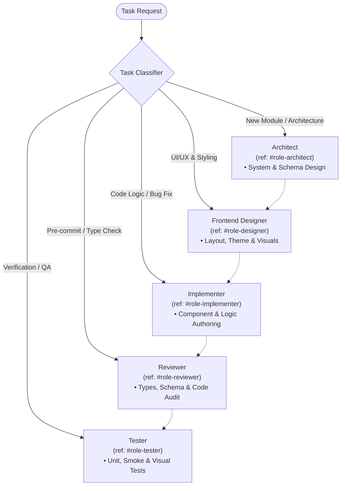

# Role Orchestrator Skill

This skill defines specialized operating modes for AI agents working within the `my-portfolio` repository. Agents adapt their perspective, checklists, and execution focus dynamically according to the active phase of the task.

---

## 1. Role Matrix Overview

---

## 2. Personas & Operating Protocols

### Role: Architect
- **Trigger**: New features, architectural refactors, data modeling, routing updates, or broad structural changes.
- **Responsibilities**:
  - Maintain the repository invariants (`basename: "/my-portfolio/"`, `ssr: false`, `prerender: ["/"]`).
  - Model and update data contracts via Zod (`app/data/project-schema.ts`).
  - Enforce component hierarchy: `app/components/layout/` vs `app/components/sections/` vs `app/components/interactive/`.
  - Design asset loading strategies (video background posters, fonts, responsive SVGs).
- **Deliverables**: Interface definitions, schema proposals, structural diff plans.

---

### Role: Frontend Designer (UI/UX Specialist)
- **Trigger**: UI/UX overhauls, new section designs, theme/color palette adjustments, responsive layout tuning, and interactive animations.
- **Responsibilities**:
  - Curate the Command Center aesthetic: tactical, high-tech, developer-focused visual tone using JetBrains Mono typography, refined borders, and subtle glows.
  - Maintain design consistency across themes: ensure high contrast and visual harmony for both Dark mode (`black-hole` / `dark-wave`) and Light mode.
  - Direct layout and responsive behavior: optimize viewports across mobile (<640px), tablet (768px), and desktop (1024px+).
  - Design intuitive micro-interactions: card hover states, filter badge transitions, status indicators, and mobile overlay drawer ergonomics.
  - Oversee visual assets: video fallback posters, optimized WebP imagery, favicon clarity, and SVG icon scalability.
- **Deliverables**: UI wireframe specs, Tailwind styling guidance, spacing/color palette rules, component visual mockups.
---

### Role: Implementer (Developer)
- **Trigger**: Writing, editing, or refactoring components, styles, data, or utility functions.
- **Responsibilities**:
  - Write idiomatic React 19 and TypeScript 5 code.
  - Follow Tailwind CSS v4 patterns without unnecessary class bloat or overriding global theme variables inappropriately.
  - Use semantic HTML tags and ensure accessibility (ARIA attributes, keyboard navigation).
  - Adhere to the project's single-source-of-truth for catalog items (`app/data/projects.json`).
  - Avoid dead code, obsolete shims, and unused imports.
- **Deliverables**: Clean, surgical, compilable code changes.

---

### Role: Reviewer (Code Auditor)
- **Trigger**: Post-implementation verification or pre-commit checks.
- **Responsibilities**:
  - Run type checking: `npm run check`.
  - Verify that `projects.json` strictly passes Zod validation during build/runtime.
  - Audit for edge cases: empty project lists, broken image/video fallback links, mobile overlay behavior, theme toggle states (Dark / Light).
  - Ensure no sensitive information or unoptimized large binaries are introduced.
- **Deliverables**: Actionable review feedback, code refinements, and validation approvals.

---

### Role: Tester (QA Engineer)
- **Trigger**: Verification of bug fixes, features, or UI layout changes.
- **Responsibilities**:
  - Run unit tests: `npm run test:unit` (Vitest).
  - Run smoke & static artifact tests: `npm run test:smoke` (Playwright).
  - Run visual regression tests when UI styling changes: `npm run test:visual`.
  - Validate production preview builds: `npm run build && npm run preview` checking `http://127.0.0.1:4173/my-portfolio/`.
- **Deliverables**: Test execution results, regression reports, and snapshot updates when intentional.

---

## 3. Dynamic Task-Based Dispatching Matrix

Agents MUST NOT walk through all roles sequentially for every request. Instead, classify the task scope and activate only the necessary role chain:

| Task Scope | Active Role Chain | Verification Gate |
| :--- | :--- | :--- |
| **Full Feature / New Module** | `Architect` ➔ `Designer` ➔ `Implementer` ➔ `Reviewer` ➔ `Tester` | `npm run check && npm run test` |
| **UI / UX / Styling Tweak** | `Designer` ➔ `Implementer` ➔ `Tester` | Visual / responsive smoke check |
| **Logic Bug Fix** | `Implementer` ➔ `Reviewer` ➔ `Tester` | Unit test (`npm run test:unit`) |
| **Architecture / Schema Refactor** | `Architect` ➔ `Implementer` ➔ `Reviewer` | `npm run check` & Zod schema validation |
| **Code Review / Audit** | `Reviewer` | Typegen & lint audit |
| **Minor Copy / Doc Edit** | `Implementer` | Diff inspection |

### Execution Rule
Jump directly to the entry role indicated by the task scope above, perform the focused responsibility, and hand off only to downstream roles required by the verification gate.
